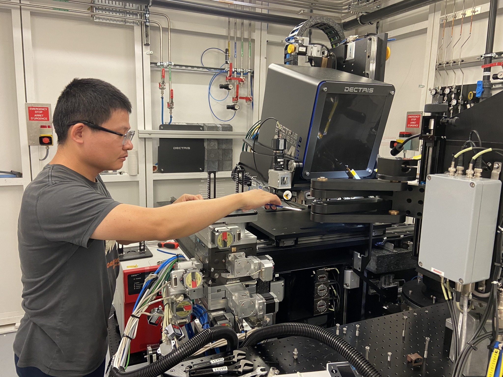
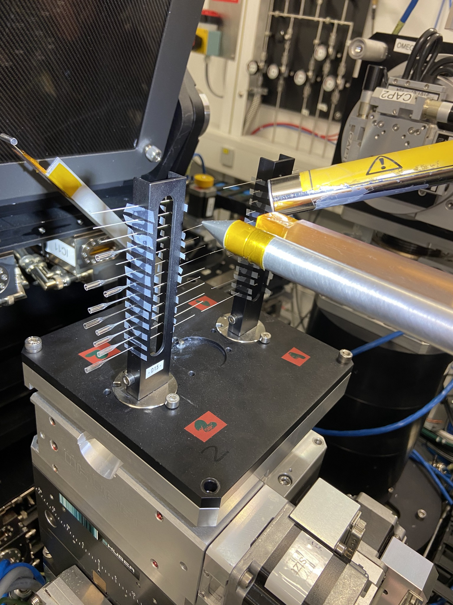
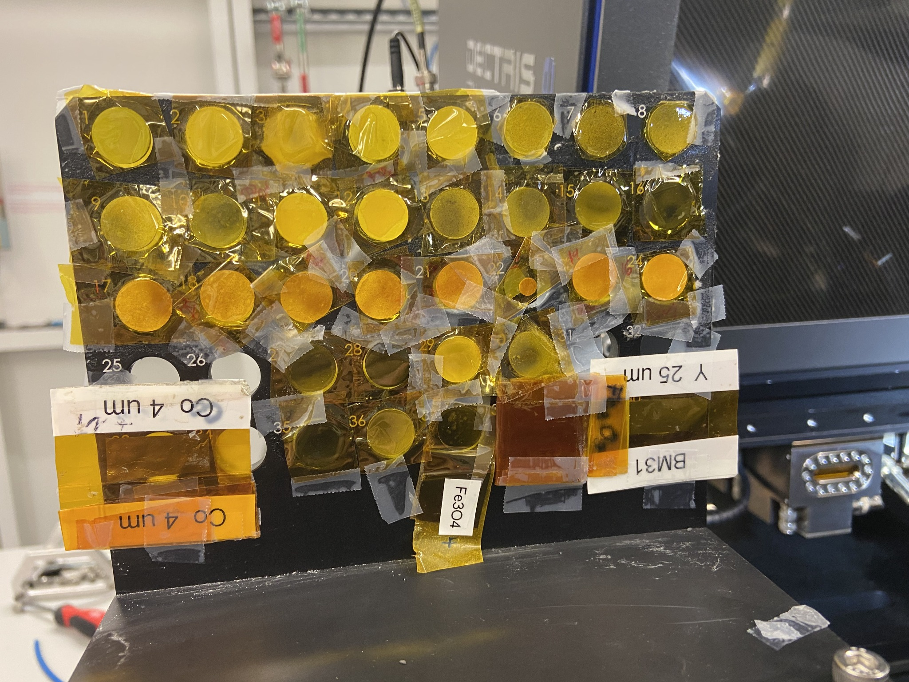

<main id="main-content" class="research-home site-inner">
<h1>News &amp; Activities</h1>

Notes and photographs from beamtime, research visits, talks and conferences.

<article class="activity-card" id="esrf-bm31-october-2024">
<figure class="activity-card__photo"> 
<figcaption>Working at the BM31 experimental station, October 2024.</figcaption>
</figure>

<h2>Beamtime at ESRF BM31</h2>

 <time datetime="2024-10">October 2024</time> · ESRF, Grenoble, France · Beamtime

In October 2024, I carried out experiments at BM31, part of the Swiss–Norwegian Beamlines at ESRF. This beamtime forms part of my work on the structure of functional and energy materials. BM31 brings diffraction, total scattering and X-ray absorption spectroscopy together, helping connect average crystal structure with local atomic environments. These photographs show work at the experimental station and the capillary and absorption-measurement sample holders.

<figure> 
<figcaption>Capillary sample holders and the surrounding experimental setup.</figcaption>
</figure>
<figure> 
<figcaption>Samples and reference foils prepared for X-ray absorption measurements.</figcaption>
</figure>

<a href="https://www.esrf.fr/UsersAndScience/Experiments/BM31">About BM31</a>

</article>

</main>
